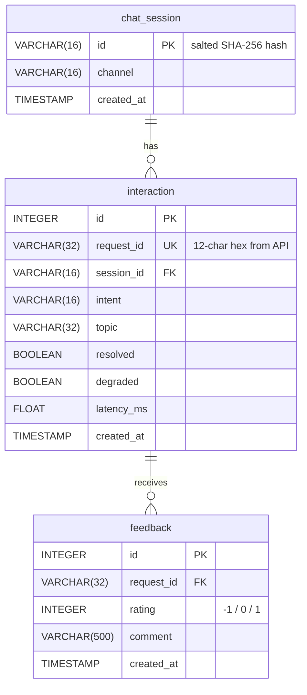

# Lab 5 — Data model worksheet
# Người thực hiện: Đạt (@EddieOuttaHere) — Issue #40 (H3 Bonus: Schema Design Review)

---

## 1. Critique the bad schema (`sql/bad_schema.sql`)

```sql
-- bad_schema.sql (tham khảo)
CREATE TABLE chats (
    id INTEGER,
    student_name TEXT,       -- real names stored with every message
    student_phone TEXT,
    message TEXT,            -- full raw message, kept forever
    answer TEXT,
    intent TEXT,             -- free text: 'fee', 'Fee', 'FEE', 'tuition'...
    time TEXT,               -- '5/10/2026 9:03 PM' as text
    feedback TEXT,           -- '1,-1,1' comma-separated list of ratings
    latency TEXT             -- '120ms'
);
```

| # | Problem | Why it hurts | Fix |
|---|---|---|---|
| 1 | **Lưu tên thật & số điện thoại sinh viên** (`student_name`, `student_phone`) trực tiếp vào bảng | Vi phạm nguyên tắc Privacy by Design — mọi câu hỏi đều dính kèm PII. Nếu DB bị rò rỉ, thông tin cá nhân lộ toàn bộ. Vi phạm Luật Bảo vệ DLCN (Việt Nam 2023) và GDPR. | Không lưu tên/số thật; chỉ lưu **hash có muối** (salted SHA-256) của session ID để trace mà không thể reverse. |
| 2 | **Lưu nguyên văn tin nhắn người dùng** (`message TEXT, kept forever`) | Raw message là PII cao nhất — có thể chứa tên, MSSV, số tài khoản. Lưu mãi mãi không có retention policy là vi phạm nguyên tắc "data minimisation". | Chỉ lưu **metadata** của tương tác: `intent`, `topic`, `resolved`, `latency_ms`. Không lưu nội dung câu hỏi. |
| 3 | **`feedback TEXT` lưu nhiều giá trị trong 1 cột** (`'1,-1,1'` comma-separated) | Vi phạm chuẩn hóa **1NF** — không thể `WHERE`, `GROUP BY`, hay `AVG` trên feedback. Mỗi phản hồi phải là 1 hàng riêng biệt để truy vấn được. | Tách thành bảng riêng `feedback` với `rating INTEGER`, `request_id` là foreign key liên kết `interaction`. |
| 4 | **Không có PRIMARY KEY rõ ràng** (`id INTEGER` nhưng không khai báo `PRIMARY KEY`) | Không đảm bảo tính duy nhất; SQLite tự dùng `rowid` nhưng ứng dụng không thể dựa vào. INSERT trùng sẽ không bị bắt. | Khai báo `id INTEGER PRIMARY KEY` hoặc dùng `UNIQUE` constraint trên `request_id`. |
| 5 | **`intent TEXT` free-text không ràng buộc** (`'fee'`, `'Fee'`, `'FEE'`, `'tuition'` cùng nghĩa nhưng khác chuỗi) | GROUP BY intent sẽ ra nhiều nhóm cho cùng 1 ý định — thống kê sai. Không thể dùng index hiệu quả. | Giới hạn bằng `CHECK (intent IN ('fee','office','faq','unknown'))` hoặc ENUM, chuẩn hóa ở tầng application. |
| 6 | **Kiểu dữ liệu sai cho `time` và `latency`** (`time TEXT = '5/10/2026 9:03 PM'`, `latency TEXT = '120ms'`) | Không thể `ORDER BY time`, `AVG(latency)`, hay so sánh thời gian khi lưu dạng chuỗi tự do. Mỗi môi trường locale cho ra format khác nhau → dữ liệu không nhất quán. | `time → created_at TIMESTAMP NOT NULL` (ISO-8601 UTC); `latency → latency_ms FLOAT NOT NULL`. |

---

## 2. Store or not? (privacy-aware storage)

| Data | Store? | Form (raw / hashed / aggregated / none) | Retention | Reason |
|---|---|---|---|---|
| raw user message | ❌ Không | none | — | PII tối đa; chỉ cần metadata để phân tích, không cần nội dung thô. |
| session id | ✅ Có | hashed — `SHA-256(salt + raw_id)[:16]` | Vĩnh viễn (vô danh hoá) | Cho phép trace session mà không reverse được về người dùng thật. |
| intent, latency, topic | ✅ Có | raw (không phải PII) | Vĩnh viễn | Cần cho analytics — thống kê intent, latency trung bình, topic tồn đọng. |
| feedback rating | ✅ Có | raw (`-1`, `0`, `1`) | Vĩnh viễn | Giá trị số trung tính, không định danh người dùng. |
| feedback comment | ✅ Có (tùy chọn) | raw, tối đa 500 ký tự | 90 ngày (đề xuất) | Có thể chứa nội dung nhận dạng — cần giới hạn độ dài và retention ngắn hơn. |
| student name / phone | ❌ Không | none | — | PII trực tiếp; không cần thiết cho bất kỳ chức năng phân tích nào. |

---

## 3. Product questions → fields

| Product question | Fields needed | Table(s) | Query sketch |
|---|---|---|---|
| Most failed intent? | `intent`, `resolved` | `interaction` | `SELECT intent, COUNT(*) AS n, SUM(CASE WHEN resolved=0 THEN 1 ELSE 0 END) AS failed FROM interaction GROUP BY intent ORDER BY failed DESC` |
| Average response time by intent? | `intent`, `latency_ms` | `interaction` | `SELECT intent, ROUND(AVG(latency_ms),1) AS avg_ms FROM interaction GROUP BY intent ORDER BY avg_ms DESC` |
| Top unresolved topics? | `topic`, `resolved`, `request_id`, `rating` | `interaction JOIN feedback` | `SELECT i.topic, COUNT(*) AS thumbs_down FROM feedback f JOIN interaction i ON f.request_id = i.request_id WHERE f.rating = -1 GROUP BY i.topic ORDER BY thumbs_down DESC LIMIT 10` |

---

## 4. ER diagram



**Giải thích quan hệ:**
- **`chat_session` → `interaction`** (1-N): Một phiên học có thể chứa nhiều lượt hỏi. Liên kết qua `session_id` (hashed) → không thể reverse về người dùng thật.
- **`interaction` → `feedback`** (1-N): Một lượt hỏi có thể nhận nhiều phản hồi từ người dùng. Liên kết qua `request_id` → đảm bảo feedback luôn trỏ đến một interaction tồn tại (referential integrity với FOREIGN KEY).

---

## 5. Tổng kết: Cách kiến trúc Lab 5 khắc phục `bad_schema.sql`

| Lỗi trong `bad_schema.sql` | Giải pháp trong Lab 5 |
|---|---|
| Lưu tên thật + số điện thoại | Không lưu PII; chỉ lưu `hash_session(salt, raw_id)` → vô danh hoá hoàn toàn |
| Lưu nguyên văn câu hỏi | Chỉ lưu metadata: `intent`, `topic`, `resolved`, `latency_ms` |
| Feedback gộp 1 cột dạng chuỗi | Bảng `feedback` riêng biệt, mỗi đánh giá là 1 hàng, có `FOREIGN KEY → interaction.request_id` |
| Thiếu Primary Key rõ ràng | Mỗi bảng có `id INTEGER PRIMARY KEY` + `UNIQUE` constraint trên các business key |
| `intent` free-text không ràng buộc | Chuẩn hoá ở tầng API (Pydantic/SQLModel), index trên cột `intent` |
| Kiểu dữ liệu sai cho thời gian/độ trễ | `created_at TIMESTAMP NOT NULL` (UTC), `latency_ms FLOAT NOT NULL` |
