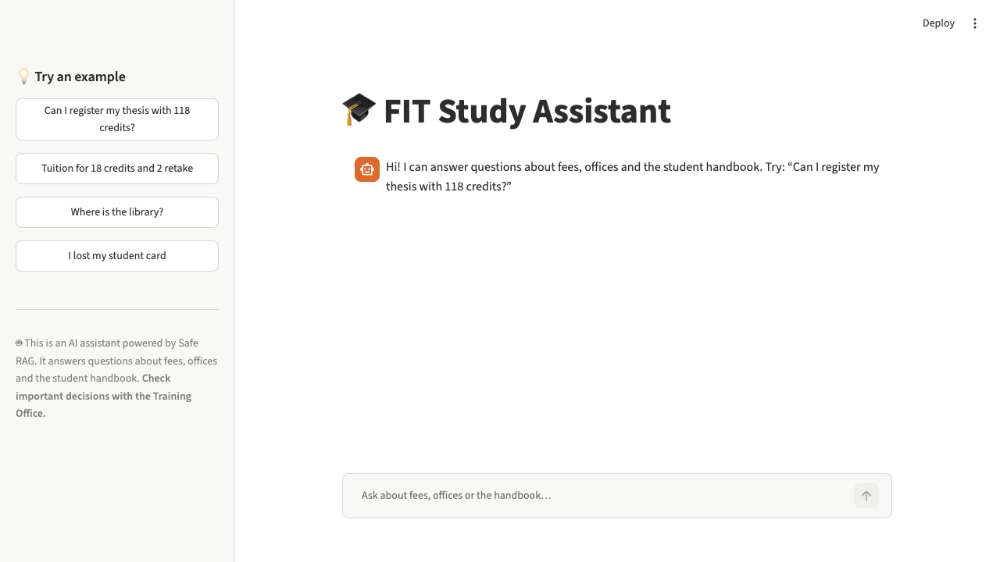
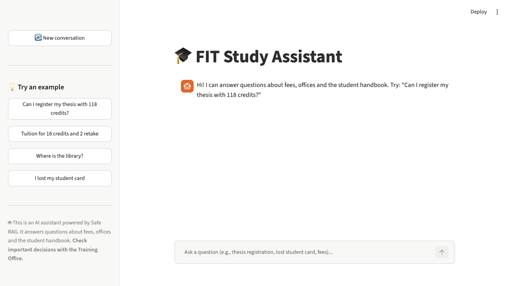

# Lab 7 homework — 10-minute usability test

**Tester (not in your team, first name only):** Minh  
**Date:** 2026-11-22  
**Task you gave them:** "Find out if you can register your thesis with 118 credits, and where to replace a lost student card."

**Rule:** do not help or explain. Watch and write down what happens.

| # | What the tester did or said | What they expected | Why the system/UI caused it | Fix idea |
|---|---|---|---|---|
| 1 | Sau khi hỏi xong câu khóa luận ("Under clause 5.3, you need at least 120 accumulated credits..."), người dùng muốn hỏi tiếp câu làm lại thẻ sinh viên nhưng lúng túng nhìn quanh màn hình, bấm F5 reload trang và hỏi: *"Có nút tạo đoạn chat mới hay làm mới cuộc trò chuyện không, hay phải gõ dồn tiếp vào đây? Nếu gõ tiếp thì hai câu hỏi không liên quan bị dính chung vào nhau."* | Có nút "New conversation" / "Clear chat" ở thanh điều hướng bên trái hoặc đầu trang để xóa lịch sử và bắt đầu phiên hỏi đáp mới sạch sẽ cho chủ đề khác (giống như ChatGPT hay Claude). | `ui/app.py` lưu toàn bộ tin nhắn trong `st.session_state.messages` và giữ nguyên `session_id` nhưng không cung cấp nút hành động nào để reset trạng thái. F5 trên trình duyệt vẫn giữ session state của Streamlit. | Thêm nút `🔄 New conversation` nổi bật ở đầu `st.sidebar` để đặt lại `st.session_state.messages` về câu chào ban đầu, sinh `session_id` mới, xóa tập `rated` và `st.rerun()`. |
| 2 | Khi mới nhìn vào giao diện trống ban đầu, người dùng chần chừ khoảng 20 giây trước ô chat và hỏi: *"Hệ thống này nhận tiếng Việt hay tiếng Anh? Gõ từ khóa ngắn như 'đổi thẻ' hay phải gõ nguyên câu hỏi dài?"* Ban đầu chỉ gõ thử `"thesis"`. | Placeholder và hướng dẫn gợi ý rõ ràng các dạng câu hỏi mẫu thực tế, cho phép người dùng biết hệ thống có thể tiếp nhận câu hỏi tự nhiên về quy chế tốt nghiệp, thẻ sinh viên, học phí. | Placeholder ban đầu chỉ có câu tiếng Anh chung chung: `"Ask about fees, offices or the handbook…"`, chưa nêu các từ khóa cụ thể gắn liền với nhu cầu sinh viên thực tế. | Cập nhật placeholder trong ô chat thành: `"Ask a question (e.g., thesis registration, lost student card, fees)..."` để gợi ý trực tiếp ngay tại vị trí nhập liệu. |
| 3 | Khi nhận được câu trả lời trích dẫn `📄 H26#5.3 — 5.3 Thesis registration`, người dùng bấm vào expander và hỏi: *"H26 nghĩa là gì vậy? Là mã phòng đào tạo, mã văn bản hay hệ thống tự sinh mã nội bộ? Có chính xác không?"* | Người dùng mong muốn được giải thích rõ nguồn trích dẫn (ví dụ: H26 = Sổ tay sinh viên 2026 - Student Handbook) để cảm thấy an tâm và tin tưởng vào tính xác thực của câu trả lời. | Hệ thống sử dụng ký hiệu rút gọn của backend (`H26`, `S26`) mà không có ghi chú chú giải chữ cái viết tắt của tài liệu. | Bổ sung ghi chú giải thích tiền tố mã văn bản trong nội dung expander và thanh sidebar (H = Handbook / Sổ tay sinh viên, S = Services). |

---

## The one change we made

- **Core UI Fix:** Thêm nút **`🔄 New conversation`** ở đầu thanh Sidebar trong `ui/app.py` kèm cập nhật placeholder trực quan hơn tại ô `st.chat_input`.
- **Hành vi xử lý:**
  - Đặt lại `st.session_state.session_id = uuid.uuid4().hex[:12]` (phiên trò chuyện hoàn toàn mới phía backend).
  - Khôi phục `st.session_state.messages = [{"role": "assistant", "content": WELCOME}]`.
  - Làm trống `st.session_state.rated = set()`.
  - Hủy trạng thái `pending` nếu có và kích hoạt `st.rerun()`.
- **Unit Test bổ sung:** Thêm test ca kiểm thử `test_ui_new_conversation_button` trong `tests/test_ui.py` sử dụng Streamlit `AppTest`, kiểm tra nút xuất hiện trong sidebar và khi bấm sẽ reset sạch sẽ toàn bộ trạng thái session.
- **Branch / PR:** `feature/issue-69-usability-test-fix` (Closes #69).

---

## Before / after screenshot

### 1. Trực quan so sánh giao diện (Before vs After)

| Trạng thái | Hình ảnh minh chứng | Mô tả chi tiết |
|:---|:---:|:---|
| **Before Fix** |  | • Sidebar chỉ có phần ví dụ (`💡 Try an example`), hoàn toàn thiếu nút tạo cuộc trò chuyện mới.<br>• Ô chat input mang placeholder tiếng Anh chung chung: `Ask about fees, offices or the handbook…`.<br>• Người dùng không thể xóa lịch sử khi chuyển nhiệm vụ. |
| **After Fix** |  | • Sidebar bổ sung nút **`🔄 New conversation`** toàn chiều rộng ở vị trí trên cùng, kèm đường phân cách rõ ràng.<br>• Ô chat input đổi thành: `Ask a question (e.g., thesis registration, lost student card, fees)...` định hướng hành động tốt hơn.<br>• Cho phép người dùng kiểm soát phiên hội thoại theo nguyên tắc *Feedback & Control* của Google PAIR. |

### 2. Sơ đồ bố cục UI thay đổi

```
TRƯỚC KHI SỬA (BEFORE):                     SAU KHI SỬA (AFTER):
┌────────────────┬──────────────────────┐   ┌────────────────┬──────────────────────┐
│ [Sidebar]      │ [Main Chat Area]     │   │ [Sidebar]      │ [Main Chat Area]     │
│                │ 🎓 FIT Study         │   │                │ 🎓 FIT Study         │
│ 💡 Try example │    Assistant         │   │ [🔄 New chat]  │    Assistant         │
│  - Thesis?     │                      │   │ ────────────── │                      │
│  - Tuition?    │ 🤖 Hi! I can answer  │   │ 💡 Try example │ 🤖 Hi! I can answer  │
│  - Library?    │    questions...      │   │  - Thesis?     │    questions...      │
│  - Lost card?  │                      │   │  - Tuition?    │                      │
│ ────────────── │                      │   │  - Library?    │                      │
│ 🤖 Info notice │                      │   │  - Lost card?  │                      │
│                │                      │   │ ────────────── │                      │
│                │ [Ask about fees...]  │   │ 🤖 Info notice │ [Ask a question...]  │
└────────────────┴──────────────────────┘   └────────────────┴──────────────────────┘
```
